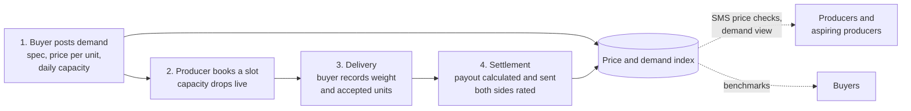
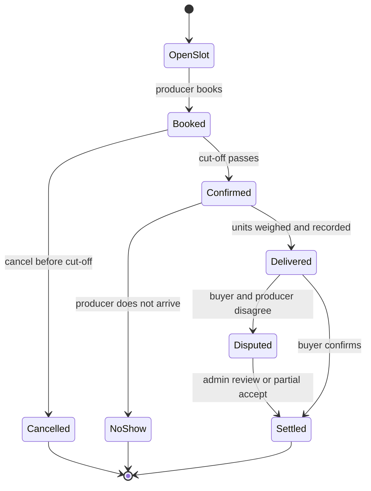
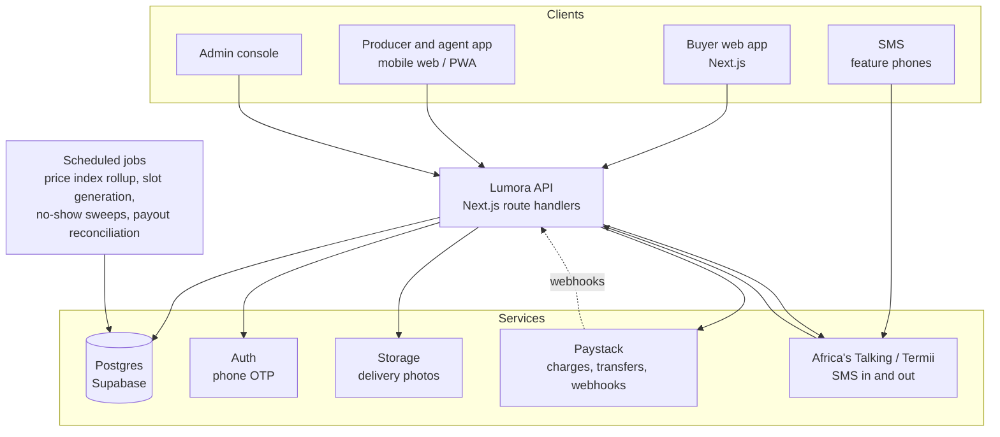
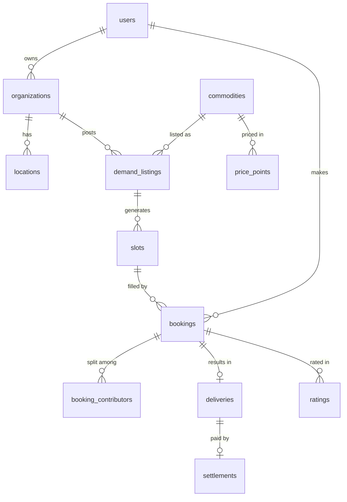

# Lumora

**Buyers are waiting. What are you selling?**

Lumora is a demand board for farm produce: live poultry, eggs, tomatoes, grains and other raw agricultural commodities. Bulk buyers such as restaurants, hotels, schools, caterers and processors publish what they need, the price they will pay per unit and how much they can take each day. Farmers and aggregators see every active buyer near them, book a slot, deliver, and get paid on the weight or quantity the buyer records.

Built for **HackJos 2026**, Track: **Market Access & Value Chains**. Launch market: Jos and the wider Plateau State, Nigeria.

---

## Table of contents

1. [Problem statement](#problem-statement)
2. [The origin story](#the-origin-story)
3. [The solution](#the-solution)
4. [Lumora is not another online marketplace](#lumora-is-not-another-online-marketplace)
5. [How it works](#how-it-works)
6. [Core concepts](#core-concepts)
7. [Who it is for](#who-it-is-for)
8. [Features](#features)
9. [SMS access for feature phones](#sms-access-for-feature-phones)
10. [Architecture](#architecture)
11. [Tech stack](#tech-stack)
12. [Data model](#data-model)
13. [Key logic](#key-logic)
14. [API reference](#api-reference)
15. [Project structure](#project-structure)
16. [Getting started](#getting-started)
17. [Demo walkthrough](#demo-walkthrough)
18. [Business model](#business-model)
19. [Roadmap](#roadmap)
20. [Related work](#related-work)
21. [Team](#team)
22. [License](#license)

---

## Problem statement

Farmers in North Central Nigeria cannot see who is buying their produce or at what price, and buyers can only reach the few suppliers who call them. Both sides lose money, and many would-be farmers never start.

Agricultural trade in the region runs on phone calls and personal networks:

- **Producers cannot see demand.** A farmer calls buyer after buyer, often only to learn the day's quota is already filled. They move stock before a sale is confirmed, waste trips, and lose perishable produce while it waits.
- **Buyers see too little supply.** Restaurants, hotels and schools buy from whoever happens to call them, with little choice of supplier and little ability to compare prices or quality.
- **Prices are opaque.** Neither side knows whether ₦3,500 per kg is a good price today, or what other buyers across town are paying.
- **New production never starts.** People with capital and land do not start poultry, turkey or vegetable farms because they cannot see a market before they invest.

There is no shared, trusted place where buyer demand and prices are visible to everyone.

**Why it matters.** Nigeria lost an estimated 30 to 40 million tonnes of food after harvest in 2025, worth roughly ₦3.5 to ₦5 trillion (OTACCWA, via Nairametrics). Fruit and vegetable losses are estimated at around 50% a year (FAO). Selling without a confirmed buyer is one direct cause: produce waits, spoils, or is dumped cheaply.

---

## The origin story

The idea came from a conversation with a friend who works at a shawarma restaurant in Jos. She described how the restaurant buys chicken:

> If you have chickens to sell, you call the restaurant. If someone already called first and filled what they need, you wait for another day. If not, they book you. You bring the birds, each one is weighed, and you are paid per kilogram. At ₦3,500 per kg, three birds of 3 kg each earn 3 x 3 x ₦3,500 = ₦31,500.

That is already a working commodity market. It has:

| Element | In the restaurant's process |
|---|---|
| A fixed bid price | ₦3,500 per kg |
| A standard unit | Live weight in kg |
| Limited capacity | A set number of birds per day |
| First-come allocation | Whoever calls first gets booked |
| Settlement on delivery | Weight x price x quantity |

What it lacks is **visibility**. It lives in phone calls, so only producers who already know the number can take part, and nobody can compare one buyer with another.

The same gap stopped one of our founders from starting a turkey farm. The question was simple and had no answer: *who do I sell to, and how do I reach them?*

Lumora takes the restaurant's own buying rules and puts them on an open board.

---

## The solution

Lumora flips the usual direction of agricultural trade. Instead of sellers listing produce and hoping buyers arrive, **buyers publish standing demand and producers fill it.**

A buyer posts a demand listing:

```
Live broilers, 2.5 to 3.5 kg each
₦3,500 per kg of live weight
80 birds per day, Monday to Saturday
Deliver to Rayfield, Jos, 7:00 to 11:00
Book by 6:00 the day before, minimum 10 birds
```

Producers see every active buyer near them, ranked by price and distance, with live remaining capacity. They book a slot, and the capacity drops for everyone else in real time. On delivery, the buyer records the weight or quantity, Lumora calculates the payout and the producer is paid. Both sides are rated.

Every posted bid and every completed delivery feeds a **price and demand index** by commodity, area and week. Producers can check it by SMS, and aspiring farmers can see real demand before investing.

---

## Lumora is not another online marketplace

This is the most important section of this document.

An online marketplace is a **catalogue of supply**. Sellers upload products, buyers browse, and a sale happens if someone finds something they like. Most agritech platforms in Nigeria follow this model, or act as operators that buy, store and resell produce themselves.

Lumora is an **order book of demand**. It is built the way commodity exchanges work: buyers post bids, and the market fills them. The difference changes who acts first, what information exists before a trade, and what problems get solved.

### Side-by-side comparison

| Question | Typical agri marketplace | Lumora |
|---|---|---|
| Who posts first? | The seller lists produce | The buyer posts demand |
| What is listed? | Products for sale | Standing bids: specification, price per unit, capacity, delivery window |
| What does the producer know before moving stock? | Nothing certain; they list and wait | A confirmed buyer, a fixed price per unit and a booked slot |
| How is price set? | Seller asks, buyer negotiates | Buyer bids openly; producers compare bids side by side |
| How is quantity managed? | Stock counts on the seller side | Buyer capacity per day, filled first come first served, with no overbooking |
| When does the producer travel? | Often before a buyer is found | Only after a booking is confirmed |
| How is payment calculated? | Agreed price per item | Recorded weight or count x posted unit price |
| What data does it produce? | Listing prices (asking prices) | Real bids and settled prices: a demand-side price index |
| Does it help before production? | No; you need produce to list | Yes; aspiring producers see demand, volume and price before they start |
| Who holds stock? | The seller or the platform | Nobody; produce moves only to a booked buyer |

### Why this distinction matters

1. **It removes the guessing.** In a marketplace, a farmer lists 100 birds and hopes. On Lumora, a farmer sees that a restaurant needs 50 birds on Thursday at ₦3,500/kg and books them. The sale is decided before the trip.
2. **It matches how bulk buyers already behave.** Restaurants and hotels already buy on fixed per-unit prices and daily limits. Lumora asks them to type that once instead of repeating it on every phone call.
3. **It cuts losses on perishables.** Produce moves only to a confirmed buyer, so live birds and tomatoes spend less time waiting.
4. **It creates better price data.** Asking prices on a marketplace tell you what sellers hope for. Bids and settled deliveries tell you what buyers actually pay.
5. **It works before production.** A marketplace cannot help someone who has nothing to sell yet. Lumora's demand view tells an aspiring turkey farmer exactly how many birds buyers near Jos want each week and at what price.

### A simple way to explain it to a judge

> A marketplace is a shop window for sellers. Lumora is a notice board for buyers of farm produce. In a shop window, the farmer waits to be found. On Lumora, the farmer sees who needs what, at what price, today, and books it.

---

## How it works



### Booking lifecycle



### Worked example

| Step | What happens |
|---|---|
| Post | Restaurant A posts 80 live broilers a day at ₦3,500 per kg |
| Book | Amina, a farmer in Bukuru, books 30 birds for Thursday. Remaining capacity drops to 50 |
| Fill | Two more producers book the remaining 50. The slot shows as full |
| Deliver | Amina delivers 30 birds weighing 92.4 kg in total |
| Settle | Payout = 92.4 kg x ₦3,500 = **₦323,400**, sent by bank transfer. Amina gets an SMS confirmation |
| Index | The settled price updates the broiler price index for Jos this week |

---

## Core concepts

| Concept | Definition |
|---|---|
| **Demand listing** | A buyer's standing request: commodity, specification, unit, price per unit, capacity per day, delivery days and window, booking cut-off, minimum quantity |
| **Slot** | One day of capacity generated from a listing, for example 80 birds on Thursday 12 November |
| **Booking** | A producer's claim on part of a slot, with a booking code |
| **Delivery** | The record of what arrived: units received, measured weight or count, declined units with reasons and photos |
| **Settlement** | The payout calculation and payment for an accepted delivery |
| **Price point** | One data point in the index, from a posted bid or a settled delivery |
| **Price index** | Median, minimum, maximum and count of prices by commodity, area and week |

---

## Who it is for

| Segment | Who they are | What they get |
|---|---|---|
| **Producers** | Poultry and crop farmers around Jos, Bukuru, Barkin Ladi and nearby areas | Confirmed buyers before moving stock, clear prices, fast payment |
| **Aggregators and agents** | Traders who pool produce from many small farmers | Many buyers in one place, volume booking, records of who supplied what |
| **Bulk buyers** | Restaurants, hotels, caterers, schools, hospitals, processors | More suppliers competing to fill a clear specification, fewer phone calls, price benchmarks |
| **Aspiring producers** | People considering poultry, turkey, eggs or vegetables | Real demand, volume and price data before they invest |

Starting commodities: **live broilers** (clear per-kg pricing, steady daily demand) and **tomatoes** (seasonal gluts, high post-harvest losses on the Plateau).

---

## Features

**P0** is required for the hackathon demo. **P1** follows in the pilot. **P2** is later.

| Area | Feature | Priority |
|---|---|---|
| Accounts | Phone number sign-in with OTP; roles for buyer, producer, agent, admin; buyer organisations with locations | P0 |
| Catalogue | Commodities with units (kg, bird, crate, basket, bag) and specification templates | P0 |
| Demand listings | Create, edit and pause listings with price, capacity, recurring days, window, cut-off and minimum quantity | P0 |
| Slots | Daily slots generated from recurring rules, with live remaining capacity | P0 |
| Board | Filter by commodity, area and date; sort by price and distance | P0 |
| Booking engine | Atomic booking with no overbooking; booking codes; cancel before cut-off | P0 |
| Delivery | Record units, weights and declines with reasons and photos | P0 |
| Settlement | Automatic payout calculation; Paystack charge and transfer (test mode for demo) | P0 |
| Price index | Index by commodity, area and week from bids and settled deliveries | P0 |
| SMS | PRICE, BUYERS, BOOK, CANCEL and DEMAND commands; booking and payout notifications | P0 |
| Ratings | Two-way ratings; fill rate and on-time rate on profiles | P1 |
| Deposits | Optional booking deposits and no-show penalties | P1 |
| Agent tools | Book on behalf of farmers and split payouts by contribution | P1 |
| Demand view | Weekly demand and price history for aspiring producers, with alerts | P1 |
| Disputes | Review queue with photos and weigh records; partial settlement | P1 |
| Price privacy | Buyers can show prices only to verified producers | P1 |
| WhatsApp and USSD | Same commands over WhatsApp and USSD | P2 |
| Logistics | Book a vehicle for a confirmed delivery through partners | P2 |
| Embedded finance | Credit for producers based on booked demand and delivery history, through lending partners | P2 |

---

## SMS access for feature phones

Many producers use feature phones. Every core producer action works by SMS.

| Producer sends | Lumora replies |
|---|---|
| `PRICE BROILER JOS` | Broiler, Jos, this week: avg ₦3,540/kg (12 bids). Highest ₦3,800. Reply BUYERS BROILER JOS for list. |
| `BUYERS BROILER JOS` | 1) Caterer D ₦3,800/kg, 40 left Thu 2) Hotel B ₦3,650/kg, 25 left Fri. Reply BOOK 1 20 THU |
| `BOOK 1 20 THU` | Booked: 20 birds, Caterer D, Thu 7 to 11am, Angwan Rukuba. Code LM-4821. Reply CANCEL LM-4821 before Wed 6pm. |
| `CANCEL LM-4821` | Booking LM-4821 cancelled. The slot has been reopened. |
| `DEMAND TURKEY JOS` | Turkey demand near Jos: 4 buyers, about 60 birds a week, avg ₦4,150/kg. |

Command grammar:

```
PRICE   <commodity> <area>
BUYERS  <commodity> <area>
BOOK    <listing number> <quantity> <day>
CANCEL  <booking code>
DEMAND  <commodity> <area>
```

---

## Architecture



Design principles:

- **Money and capacity are always correct.** Bookings run in a single database transaction. Payouts are idempotent and confirmed by payment webhooks.
- **Works on poor connections.** Light mobile pages, and SMS for producers without data.
- **Critical logic lives next to the data.** Booking is a Postgres function, not application code, so concurrent requests cannot overbook a slot.
- **Privacy by default.** Producer phone numbers are hidden from buyers until a booking exists. The public board shows locations at area level only.

---

## Tech stack

| Layer | Choice | Why |
|---|---|---|
| Frontend | Next.js (App Router), TypeScript, Tailwind CSS | One codebase for buyer web, producer mobile web and admin |
| Backend | Next.js route handlers; Postgres functions for booking | Fast to ship; critical logic sits next to the data |
| Database and auth | Supabase: Postgres, phone OTP, row-level security, realtime, storage | Managed, realtime capacity updates, simple access rules |
| Payments | Paystack: charges, transfers, webhooks | Widely used in Nigeria; supports payouts to bank accounts |
| Messaging | Africa's Talking or Termii | Inbound and outbound SMS for feature phones |
| Charts | Recharts | Lightweight charts for the price index |
| Hosting | Vercel and Supabase Cloud | No infrastructure to run during the pilot |

---

## Data model



| Table | Key fields |
|---|---|
| `users` | id, phone, name, role, language, area |
| `organizations` | id, name, type (restaurant, hotel, school, processor), owner_id, verified |
| `locations` | id, org_id, label, area, lat, lng |
| `commodities` | id, name, unit (kg, bird, crate, basket, bag), spec_template |
| `demand_listings` | id, org_id, commodity_id, spec, unit_price, capacity_per_day, days_of_week, window, cutoff_hours, min_qty, deposit_pct, status |
| `slots` | id, listing_id, date, capacity_total, capacity_remaining |
| `bookings` | id, slot_id, producer_id, agent_id, qty, code, status, deposit_ref, created_at |
| `booking_contributors` | id, booking_id, farmer_name, farmer_phone, qty_share |
| `deliveries` | id, booking_id, units_received, measured_qty, declined_units, decline_reason, photos, recorded_by |
| `settlements` | id, delivery_id, gross, buyer_fee, producer_net, charge_ref, transfer_ref, status |
| `ratings` | id, booking_id, from_user, to_user, score, note |
| `price_points` | id, commodity_id, area, unit, price, source (bid or settled), week, created_at |
| `messages` | id, user_id, channel, direction, body, status |
| `audit_log` | id, entity, entity_id, action, actor_id, payload, created_at |

---

## Key logic

### Booking without overbooking

The booking function locks the slot row, checks capacity, records the booking and decrements capacity in one transaction. Two producers trying to book the last 20 birds at the same moment cannot both succeed.

```sql
create or replace function book_slot(p_slot uuid, p_producer uuid, p_qty int)
returns uuid as $$
declare
  s slots%rowtype;
  b uuid;
begin
  select * into s from slots where id = p_slot for update;

  if s.capacity_remaining < p_qty then
    raise exception 'insufficient_capacity';
  end if;

  insert into bookings (slot_id, producer_id, qty, status, code)
  values (p_slot, p_producer, p_qty, 'booked', gen_booking_code())
  returning id into b;

  update slots
  set capacity_remaining = capacity_remaining - p_qty
  where id = p_slot;

  return b;
end;
$$ language plpgsql;
```

The production version also checks the booking cut-off, the listing's minimum quantity and whether the listing is active.

### Settlement

```
gross        = accepted quantity x unit price
               (for weight-priced goods: total accepted kg x price per kg)
buyer_fee    = 1.5% of gross, charged to the buyer
producer_net = gross - penalties (if any)
```

Each settlement has an idempotency key. A payout is marked paid only when the Paystack transfer webhook confirms it.

### Price index

A nightly job groups price points by commodity, area and week, and stores the median, minimum, maximum and count. Settled deliveries are weighted above posted bids, because they reflect real transactions. Weeks with fewer than three data points show as "insufficient data" rather than a price.

---

## API reference

| Method | Endpoint | Purpose |
|---|---|---|
| `POST` | `/api/listings` | Create a demand listing |
| `PATCH` | `/api/listings/:id` | Edit or pause a listing |
| `GET` | `/api/board?commodity=&area=&date=` | Producer board with remaining capacity |
| `POST` | `/api/slots/:id/book` | Book part of a slot |
| `POST` | `/api/bookings/:id/cancel` | Cancel a booking before cut-off |
| `POST` | `/api/bookings/:id/delivery` | Record units, weights and declines |
| `POST` | `/api/deliveries/:id/settle` | Confirm delivery and trigger payment |
| `GET` | `/api/index?commodity=&area=` | Price index series |
| `GET` | `/api/demand?commodity=&area=` | Demand volume and price history |
| `POST` | `/api/webhooks/paystack` | Payment events |
| `POST` | `/api/webhooks/sms` | Inbound SMS commands |

Example: create a listing

```http
POST /api/listings
Content-Type: application/json

{
  "commodity": "live_broiler",
  "spec": "2.5 to 3.5 kg each, healthy, no visible injuries",
  "unit": "kg",
  "unit_price": 3500,
  "capacity_per_day": 80,
  "days_of_week": ["mon", "tue", "wed", "thu", "fri", "sat"],
  "window": { "start": "07:00", "end": "11:00" },
  "cutoff_hours": 24,
  "min_qty": 10,
  "location_id": "loc_rayfield"
}
```

Example: book a slot

```http
POST /api/slots/slot_2026_11_12_rayfield/book
Content-Type: application/json

{ "qty": 30 }
```

```json
{
  "booking_id": "bk_8f21",
  "code": "LM-4821",
  "status": "booked",
  "slot_capacity_remaining": 50
}
```

---

## Project structure

```
lumora/
├── app/
│   ├── (buyer)/              # buyer dashboard: listings, bookings, deliveries
│   ├── (producer)/           # producer board, bookings, payouts (mobile first)
│   ├── (admin)/              # verification and disputes
│   ├── index/                # public price index
│   ├── demand/               # demand view for aspiring producers
│   └── api/                  # route handlers and webhooks
├── lib/
│   ├── booking.ts            # booking and cancellation helpers
│   ├── settlement.ts         # payout calculation
│   ├── sms/                  # command parser and reply templates
│   ├── paystack.ts           # charges, transfers, webhook verification
│   └── supabase.ts           # database client
├── supabase/
│   ├── migrations/           # schema, functions, RLS policies
│   └── seed.sql              # demo buyers, producers, listings and prices
├── jobs/
│   ├── generate-slots.ts
│   ├── rollup-index.ts
│   └── reconcile-payouts.ts
├── components/
├── public/
└── README.md
```

---

## Getting started

### Prerequisites

- Node.js 20 or later
- A Supabase project
- A Paystack account (test keys)
- An Africa's Talking or Termii sandbox account

### Setup

```bash
git clone https://github.com/<your-org>/lumora.git
cd lumora
npm install
cp .env.example .env.local
```

Fill in `.env.local`:

```bash
NEXT_PUBLIC_SUPABASE_URL=
NEXT_PUBLIC_SUPABASE_ANON_KEY=
SUPABASE_SERVICE_ROLE_KEY=

PAYSTACK_SECRET_KEY=sk_test_xxx
PAYSTACK_PUBLIC_KEY=pk_test_xxx

SMS_PROVIDER=africastalking        # or termii
SMS_API_KEY=
SMS_USERNAME=sandbox
SMS_SENDER_ID=LUMORA

LUMORA_BUYER_FEE_PCT=1.5
```

Apply the schema and seed demo data:

```bash
npx supabase db push
npx supabase db seed
```

Run the app:

```bash
npm run dev
```

Open `http://localhost:3000`.

### Testing SMS locally

Point the SMS provider's inbound callback at `/api/webhooks/sms` through a tunnel such as ngrok, or use the built-in SMS simulator at `/dev/sms` to send commands without a phone.

---

## Demo walkthrough

| Time | On screen | What it shows |
|---|---|---|
| 0:00 | The restaurant chicken story and the turkey farm that never started | A real, familiar problem |
| 0:30 | A Jos restaurant posts 80 broilers a day at ₦3,500/kg | Buyers publish demand in a minute |
| 0:50 | A farmer in Bukuru texts `BUYERS BROILER JOS` and books 30 birds. Capacity drops to 50 | Feature-phone access and live booking |
| 1:20 | A second producer books the remaining 50. The slot shows as full | First come, first served, with no overbooking |
| 1:40 | Delivery: 30 birds, 92.4 kg. Payout of ₦323,400 calculated and sent; SMS received | Fair settlement and fast payment |
| 2:15 | The price index updates; the demand view shows turkey demand around Jos | Market data, and planning before production |
| 2:40 | Business model and pilot plan | A path beyond the hackathon |

---

## Business model

| Stream | How it works | When |
|---|---|---|
| Transaction fee | 1.5% of settled value, charged to the buyer | Pilot |
| Buyer Pro | Multiple locations, supplier analytics, price benchmarks | Phase 2 |
| Data | Aggregated price and demand reports for processors, lenders and programmes | Phase 2 |
| Embedded finance | Fees on credit offered by partner lenders against booked demand | Phase 3 |
| Logistics | Referral fee on vehicles booked for deliveries | Phase 3 |

---

## Roadmap

| Phase | Window | Outcomes |
|---|---|---|
| 0. HackJos build | 4 to 6 Nov 2026 | Full loop working end to end with demo data |
| 1. Jos pilot | Dec 2026 to Feb 2027 | 20 anchor buyers, broilers and tomatoes, SMS live, real payments, first price index |
| 2. Plateau rollout | Mar to Jun 2027 | Eggs, Irish potato and grains; Hausa interface; Buyer Pro; agent payout splits |
| 3. North Central | Jul to Dec 2027 | Abuja buyers sourcing from Nasarawa, Niger and Benue; WhatsApp and USSD |
| Partners | From May 2027 | Lending partners for credit on booked demand; logistics partners for delivery |

---

## Related work

Several Nigerian companies connect farmers and buyers. Most are supply-led marketplaces, or operators that finance, store and resell produce themselves.

| Company | Model | How Lumora differs |
|---|---|---|
| Agriarche (Kasuwa) | Platform connecting smallholders, aggregators and industrial buyers, with trading, logistics, price tracking and payments | Lumora is demand-first: buyers publish bids and capacity that any producer can book |
| ThriveAgric | Finances farmers, then aggregates and supplies grains through a large warehouse network | Lumora holds no stock and focuses on perishables and smaller lots |
| Voriancorelli | B2B marketplace for aggregators, processors, logistics and financiers | Lumora reaches restaurants, hotels and schools, with per-unit bids visible to producers |
| Zowasel | Online commodity marketplace with a price index and financing | Lumora's index comes from bids and settled deliveries, and is free to producers by SMS |
| Cubeseed Africa | Connects growers to restaurants and hotels using escrow | Lumora adds open bid prices, live capacity slots and a demand view for aspiring producers |
| AFEX | Regulated commodity exchange with warehouse receipts for grains | Lumora handles spot procurement of perishables and live produce |

Descriptions are based on public sources and may not cover every current feature.

---

## Team

| Name | Role |
|---|---|
| | |
| | |
| | |

---

## License

To be decided by the team. MIT is recommended for the hackathon submission.

---

*Sources for figures in this document: Nairametrics (OTACCWA post-harvest loss estimate, February 2026); Grants Database analysis citing the FAO food systems profile and Nigeria's National Agri-Food Systems Investment Plan (2026). Example prices and quantities in this README are illustrative demo data.*