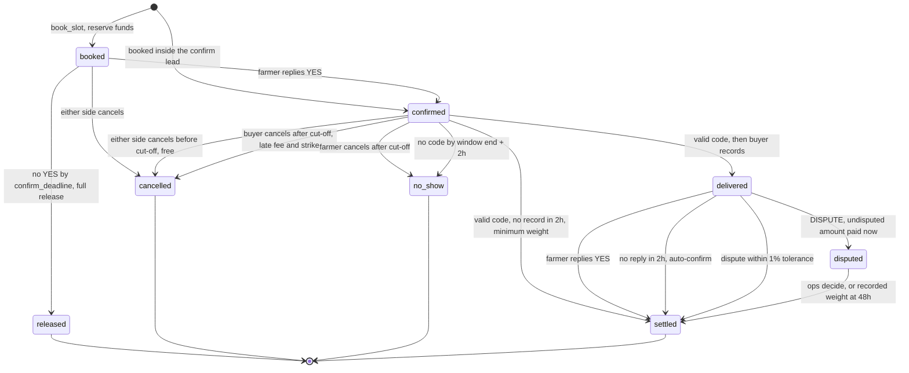

# Lumora money flow

Booking, delivery and settlement rules, for engineers working on the wallet, the SMS channel or operations. All amounts are integers in kobo.

Money only moves on proof, and every waiting state has a deadline with an automatic default outcome.

## Needed from the wallet owner

The wallet, merged to `main` in PR #8, is a UI with API stubs. It stores no balance and no ledger, and its webhook credits nothing. So the ledger is implemented here, in `supabase/migrations/*_money_*.sql`, behind `lib/money/wallet-adapter.ts`. None of the wallet's files are edited.

| # | Needed | Why | Blocks |
|---|---|---|---|
| 1 | Decide who owns the ledger. Either adopt the `money_` ledger, or replace the `wallet_*` SQL functions with your own, keeping their signatures | The wallet has no storage. Two ledgers can't both be the truth | Launch |
| 2 | Point the Flutterwave dashboard webhook at `/api/money/webhooks/flutterwave`, or forward your `/api/webhooks/flutterwave` to it | Your route returns 200 and credits nothing. Its docs don't say an account can have more than one webhook URL | Deposits, payouts |
| 3 | Remove card funding from `app/dashboard/wallet/page.tsx` (it defaults to `"card"`) and `api/wallet/fund` | The pilot is bank transfer only. `money_credit_deposit` refuses non-bank-transfer deposits and raises an alert, so a card payment would take money without crediting anyone | Launch |
| 4 | Replace `api/wallet/fund` with `lib/money/flutterwave.ts#createVirtualAccount`, and collect the BVN or NIN that a static virtual account requires | Deposits have to map to a buyer through `tx_ref` in `money_funding_accounts`. `Date.now()` references can't | Deposits |
| 5 | Route `api/wallet/withdraw` through a ledger call. `wallet_withdraw` doesn't exist yet (signature below) | The route sends real transfers without debiting anything, which would break reconciliation on the first withdrawal | Launch |
| 6 | Fix three bugs in your Flutterwave code (below) | Each one fails in production | See below |
| 7 | Confirm the items under [Unverified Flutterwave details](#unverified-flutterwave-details) in test mode | The docs don't settle them | Live keys |

**Bugs seen in the wallet code**

- `api/wallet/withdraw`: account resolve is sent as `GET` with a query string. [The reference](https://developer.flutterwave.com/reference/resolve-account-transfer-details) specifies `POST` with a JSON body.
- `api/webhooks/flutterwave`: `if (secretHash && signature !== secretHash)` skips verification when the secret is unset. It has to reject instead. It also compares without a constant-time check, and handles a `transfer.failed` event that [the webhook docs](https://developer.flutterwave.com/v3.0/docs/webhooks) don't list. Failures arrive as `transfer.completed` with `data.status: FAILED`.
- `api/wallet/withdraw`: the name check compares only the first word the user typed, so it isn't a real match. `lib/money/rules.ts#namesMatch` can replace it.

**Function that doesn't exist yet**

```sql
-- TODO(wallet owner): buyer or farmer withdrawal. Must debit the ledger inside one transaction
-- before any transfer is created.
wallet_withdraw(p_user uuid, p_amount_kobo bigint, p_bucket money_bucket, p_idem text) returns jsonb
```

## Other things that weren't there

The brief assumed these exist. They don't, on any branch.

| Assumed | Found | What this work does |
|---|---|---|
| Schema in `supabase/migrations` | The folder is empty | Creates the README's base tables in `*_money_00_base.sql`, with `create table if not exists`. The buyer is a user on `demand_listings.buyer_id`; the README's `organizations` layer is left out |
| SMS webhook | None. `africastalking` is installed but unused | Creates `/api/webhooks/sms` |
| Supabase auth | The app signs in with Firebase | RLS reads the Firebase uid from `auth.jwt()`. **Supabase must be set up to trust Firebase tokens (third-party auth), or RLS denies everyone** |
| `README.md` says Paystack | The brief says Flutterwave | Follows the brief. The README still needs updating |

Migrations are named `<timestamp>_money_*.sql`, because the Supabase CLI only applies files that start with a timestamp.

## Decisions to check

The brief left these open or had a conflict. Each is a constant or one function, so it's cheap to change.

| # | Gap | Decision |
|---|---|---|
| 1 | The farmer is asked at `confirm_by`, 24 hours before the window, and must answer "by the cut-off". With the README's `cutoff_hours: 24` those are the same moment, leaving no time to reply | New constant `CONFIRM_REPLY_HOURS = 6`. Deadline is the later of the cut-off and `confirm_by + 6h`, stored in `bookings.confirm_deadline` |
| 2 | Capacity released at the cut-off is offered to other farmers, but the slot no longer takes bookings | Release sets `slots.reopened_until`, `REOPEN_LEAD_HOURS = 4` before the window. Booking is allowed until then |
| 3 | A farmer who books inside the 24-hour lead would be asked to confirm what they just booked | Those bookings start as `confirmed` |
| 4 | `DISPUTE <code>` carries no claim, so "the difference" can't be calculated | Grammar is `DISPUTE <code> [kg]`. Without a figure, the difference is everything left in the hold |
| 5 | The 1.5% buyer fee comes from `buyer_available`, which may be empty after settlement. Balances can't go negative | Whatever is available is charged. The rest is recorded in `money_receivables` and collected from the next deposit |
| 6 | The no-show buyer share and the late-cancel fee aren't given | `NO_SHOW_FEE_BUYER_SHARE_PCT = 50`, `LATE_CANCEL_FEE_PCT = 5` |
| 7 | A farmer can deliver more than the maximum weight, so gross could exceed the reserve | Gross is capped at the reserve, and the cap is logged in `money_events` |
| 8 | `arrived` isn't in the status enum | The status stays `confirmed`, with `arrived_at` set |
| 9 | "Buyer didn't record" needs a strike, but the kinds listed don't cover it | Adds strike kind `no_record` |
| 10 | Nothing says how a farmer reports a buyer who refuses to give the code. As written, that farmer would be marked a no-show | Ops call `money_report_refused_code`, which strikes the buyer, cancels the booking and returns the reserve. There is no SMS command or admin button yet, so **farmers need a phone number to call, and ops need a way to run it** |
| 11 | SMS has no command for declaring stock, so requiring a declaration would block every SMS booking | The stock limit applies only when the farmer has declared stock for that date |
| 12 | `BOOK <n>` refers to a numbered list, but no list command was requested | Adds `BUYERS <commodity>` |
| 13 | The brief's formula assumes weight-priced goods | For baskets and crates, set `min_unit_weight_kg = max_unit_weight_kg = 1` and record units as kg. Bookings on listings without weights are refused |
| 14 | A bank transfer can't be refused, so the ₦500,000 cap can't stop one arriving | The excess goes to bucket `buyer_over_cap`, raises an alert, and is refunded after `OVER_CAP_REFUND_HOURS = 48` |
| 15 | Reconciliation as worded includes `farmer_paid`, money that has already left Flutterwave | Compares `buyer_available + buyer_reserved + buyer_over_cap + farmer_pending + lumora_revenue` to Flutterwave balance + in-flight payouts |
| 17 | A custom dispute amount may go up to the reserve, but the rest of the reserve goes back to the buyer when a dispute opens | The custom amount is limited to what's still held. The page explains this if ops go over |
| 16 | The plain delivery code has to reach the buyer once, while only the hash is stored | `book_slot` returns it to the server, which SMSes the buyer and strips it from the farmer's response. If that SMS fails, the buyer can issue a new one with `money_regenerate_code` |

## State diagram



## Deadlines

Every value is in `lib/money/rules.ts`. The same numbers are in the SQL function `money_rule`, and a test fails if they differ.

| Waiting for | Deadline | Default outcome |
|---|---|---|
| Farmer's YES | `confirm_deadline` | `released`: full reserve returned, capacity reopened, up to 10 nearby followers told |
| Farmer's arrival code | Window end + `NO_SHOW_GRACE_HOURS` (2) | `no_show`: full reserve returned, strike, fee of `NO_SHOW_FEE_PCT` (5%) queued against the next payout |
| Buyer's record | Valid code + `BUYER_RECORD_HOURS` (2) | Settle booked qty × minimum weight × price, buyer strike |
| Farmer's reply | Record + `FARMER_REPLY_HOURS` (2) | Settle with `auto_confirmed = true` |
| Ops decision | Dispute + `DISPUTE_DECISION_HOURS` (48) | Pay the recorded weight, escalate an alert |
| Over-cap refund | Deposit + `OVER_CAP_REFUND_HOURS` (48) | Refund the excess to the sender |
| Failed payout | Retried daily | Stays in `farmer_pending`, farmer told by SMS. **This wait has no end date, because the money belongs to the farmer and needs a working account. An alert is raised after 3 attempts** |

Two no-shows in 30 days stop a farmer booking for 14 days. Two `refused_code` strikes pause a buyer's listings until review. That review has no deadline, but it holds no money, because held funds stay in `buyer_available`.

## Ledger

`money_ledger` is append-only. A trigger applies each entry to `money_balances` and `money_holds`, and those tables refuse direct writes. Balance rows have a non-negative check, so overdrawing fails the transaction.

| Bucket | Meaning |
|---|---|
| `buyer_available` | Funded, uncommitted |
| `buyer_reserved` | Locked against one booking, one `money_holds` row per booking |
| `buyer_over_cap` | Above the funding cap, waiting for a refund |
| `farmer_pending` | Earned, payout not confirmed |
| `farmer_paid` | Payout confirmed by Flutterwave |
| `lumora_revenue` | Fees earned, less provider fees. May go negative |
| `external` | The outside world. The counter-entry for deposits, payouts and refunds. Negative by design |

## Adapter interface

`lib/money/wallet-adapter.ts` is the only TypeScript file that names a ledger function. Booking and settlement need to reserve and pay inside their own transaction, so they call the same `wallet_*` functions from SQL. Replacing the wallet means replacing those functions.

```ts
interface WalletAdapter {
  getAvailable(buyerId: string): Promise<number>;
  reserve(bookingId: string, buyerId: string, amountKobo: number): Promise<void>;
  release(bookingId: string, amountKobo: number, reason: string): Promise<void>;
  settle(bookingId: string, farmerId: string, amountKobo: number): Promise<void>;
  markPaid(payoutId: string): Promise<void>;
  feeFromNextPayout(farmerId: string, amountKobo: number, reason: string): Promise<void>;
}
```

## Flutterwave details

| Use | Call | Source |
|---|---|---|
| Webhook signature | `verif-hash` header equals the secret hash, constant-time. Reject if missing. Respond 200 | [Webhooks](https://developer.flutterwave.com/v3.0/docs/webhooks) |
| Deposit event | `charge.completed`, `data.status: successful` | Webhooks |
| Transfer event | `transfer.completed`, `data.status: SUCCESSFUL` or `FAILED` | Webhooks |
| Verify deposit | `GET /v3/transactions/{id}/verify`, match status, amount, currency, `tx_ref` | [Verify](https://developer.flutterwave.com/v3.0/reference/verify-transaction) |
| Virtual account | `POST /v3/virtual-account-numbers`, `is_permanent: true`, needs BVN or NIN | [NGN virtual accounts](https://developer.flutterwave.com/v3.0/docs/ngn-virtual-accounts) |
| Resolve account | `POST /v3/accounts/resolve`, JSON body | [Resolve](https://developer.flutterwave.com/reference/resolve-account-transfer-details) |
| Transfer | `POST /v3/transfers` | [Create](https://developer.flutterwave.com/v3.0/reference/create-a-transfer) |
| Fetch transfer | `GET /v3/transfers/{id}` | [Get](https://developer.flutterwave.com/v3.0/reference/get-a-transfer) |
| Find by reference | `GET /v3/transfers?reference=` | [List](https://developer.flutterwave.com/v3.0/reference/get-all-transfers) |
| Balance | `GET /v3/balances/NGN` | [Balance](https://developer.flutterwave.com/v3.0/reference/get-balances-per-currency) |

### Unverified Flutterwave details

The docs don't settle these. Check each in test mode before using live keys.

- **Duplicate references.** The docs call `reference` unique, but don't say what a repeat does. So idempotency doesn't rely on it: a row claim in `money_payouts` plus a lookup by reference before every create.
- **Amount units.** The transfer and balance pages type amounts as integers without naming a unit. This code assumes whole naira with decimals allowed. A transfer of ₦323,400.50 is the case to test.
- **`GET /v3/transfers?reference=`.** The parameter is listed, but the page doesn't say it filters. The code also checks each returned row's reference.
- **Retry and refund.** `POST /v3/transfers/{id}/retries` and `POST /v3/transactions/{id}/refund` are from memory. Their doc pages returned 404 when checked. A retried transfer may come back with a suffix on its reference, so the webhook reads the settlement id from the start of the reference.
- **Webhook retries.** Flutterwave only retries failed webhooks if retries are turned on in the dashboard (3 times, 30 minutes apart). Turn them on.
- **Deposit `payment_type`.** The code accepts values containing `bank`.
- **Balance for reconciliation.** The code uses `ledger_balance`, since deposits may not be in `available_balance` yet. Confirm this behaves as expected.
- **Sender spoofing.** Africa's Talking webhooks carry no signature, so `/api/webhooks/sms` relies on a secret token in the URL. Check whether the provider offers more.

## Scheduling

| Job | Runs | What it needs |
|---|---|---|
| `money_sweep()`, the deadline defaults | Every 5 minutes through `pg_cron`, scheduled by the migration if the extension is available | Nothing else. Deadlines fire even if the app is down |
| `GET /api/cron/money` runs the sweep, payouts, refunds and SMS | Every 5 minutes. **Not scheduled yet** | A scheduler that sends `Authorization: Bearer $CRON_SECRET`. Vercel Hobby only allows daily crons, so this needs Vercel Pro, `pg_cron` with `pg_net`, or an external scheduler |
| `GET /api/cron/money?task=reconcile` | Nightly. **Not scheduled yet** | The same |

Until the route is scheduled, deadlines still move money inside the ledger, but no SMS or payout goes out.

## Tests

`pnpm test:money` from `front-end/`. It starts a throwaway Postgres, applies the real migrations on top of `tests/money/supabase-stub.sql`, and runs the real functions. Flutterwave and SMS are fakes. Set `TEST_DATABASE_URL` to use your own database. It needs a local Postgres with `pgcrypto`.

The tests ran on Postgres 18. `supabase/config.toml` says 15, and the migrations haven't been applied to real Supabase yet.

## Environment variables

`FLUTTERWAVE_SECRET_KEY` and `FLUTTERWAVE_WEBHOOK_HASH` match the wallet's. New ones: `SUPABASE_SERVICE_ROLE_KEY`, `SMS_WEBHOOK_TOKEN`, `CRON_SECRET`, `AFRICASTALKING_USERNAME`, `AFRICASTALKING_API_KEY`, `AFRICASTALKING_SENDER_ID`.
