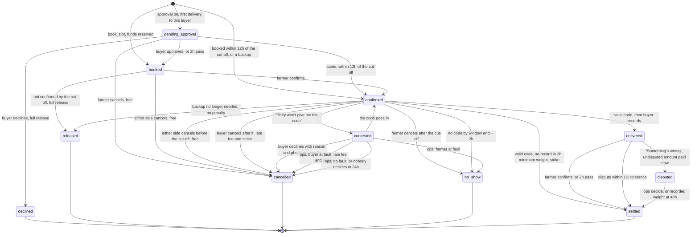

# Lumora money flow

Booking, delivery and settlement rules, for engineers working on the wallet, notifications or operations. All amounts are integers in kobo.

**How the database is managed has changed.** The original migrations were removed and the live database edited directly, so `supabase/migrations` holds only the `flow_` files, which go on top of what's live. Apply them in order through the SQL Editor. `tests/money/baseline` keeps the earlier schema so tests can still build a database.

**The provider has since moved to Paystack** (`lib/money/paystack.ts`, `/api/webhooks/paystack`). The Flutterwave sections below describe the earlier design, and need rewriting along with `tests/money/flutterwave.test.ts`, which still targets it.

Money only moves on proof, and every waiting state has a deadline with an automatic default outcome.

## Needed from the wallet owner

The wallet, merged to `main` in PR #8, is a UI with API stubs. It stores no balance and no ledger, and its webhook credits nothing. So the ledger is implemented here, in `supabase/migrations/*_money_*.sql`, behind `lib/money/wallet-adapter.ts`. None of the wallet's files are edited.

| # | Needed | Why | Blocks |
|---|---|---|---|
| 1 | Decide who owns the ledger. Either adopt the `money_` ledger, or replace the `wallet_*` SQL functions with your own, keeping their signatures | The wallet has no storage. Two ledgers can't both be the truth | Launch |
| 2 | Point the Flutterwave dashboard webhook at `/api/money/webhooks/flutterwave`, or forward your `/api/webhooks/flutterwave` to it | Your route returns 200 and credits nothing. Its docs don't say an account can have more than one webhook URL | Deposits, payouts |
| 3 | Remove card funding from `app/dashboard/wallet/page.tsx` (it defaults to `"card"`) and `api/wallet/fund` | The pilot is bank transfer only. `money_credit_deposit` refuses non-bank-transfer deposits and raises an alert, so a card payment would take money without crediting anyone | Launch |
| 4 | Replace `api/wallet/fund` with `lib/money/flutterwave.ts#createVirtualAccount`, and collect the BVN or NIN that a static virtual account requires | Deposits have to map to a buyer through `tx_ref` in `money_funding_accounts`. `Date.now()` references can't | Deposits |
| 5 | Route `api/wallet/withdraw` through a ledger call. `wallet_withdraw` doesn't exist yet (signature below) | The route sends real transfers without debiting anything, which would break reconciliation on the first withdrawal | Launch |
| 6 | Fix three bugs in your Flutterwave code (below) | Each one fails in production | See below |
| 7 | Confirm the items under [Unverified Flutterwave details](#unverified-flutterwave-details) in test mode | The docs don't settle them | Live keys |
| 8 | If you replace the `wallet_*` functions, also map the three direct `money_post` calls that are new here: `farmer_fee:` (hold to revenue, in `money_pay_farmer`), `backup_repay:` (available back to a hold, in `money_close_backup`) and the fee split in `money_pay_farmer` | They have to share a transaction with the booking change, and the adapter has no method for them | Replacing the ledger |
| 9 | Make `wallet_withdraw` take what a farmer owes first, or say why not | No-show fees come off the next payout. A farmer who withdraws `farmer_pending` directly would skip them, and the buyer would never get theirs | Withdrawals |

**Bugs seen in the wallet code**

- `api/wallet/withdraw`: account resolve is sent as `GET` with a query string. [The reference](https://developer.flutterwave.com/reference/resolve-account-transfer-details) specifies `POST` with a JSON body.
- `api/webhooks/flutterwave`: `if (secretHash && signature !== secretHash)` skips verification when the secret is unset. It has to reject instead. It also compares without a constant-time check, and handles a `transfer.failed` event that [the webhook docs](https://developer.flutterwave.com/v3.0/docs/webhooks) don't list. Failures arrive as `transfer.completed` with `data.status: FAILED`.
- `api/wallet/withdraw`: the name check compares only the first word the user typed, so it isn't a real match. `lib/money/rules.ts#namesMatch` can replace it.

**Function that doesn't exist yet**

```sql
-- TODO(wallet owner): buyer or farmer withdrawal. Must debit the ledger inside one transaction
-- before any transfer is created.
wallet_withdraw(p_user uuid, p_amount_kobo bigint, p_bucket money_bucket, p_idem text) returns jsonb
```

## Other things that weren't there

The brief assumed these exist. They don't, on any branch.

| Assumed | Found | What this work does |
|---|---|---|
| Schema in `supabase/migrations` | The folder is empty | Creates the README's base tables in `*_money_00_base.sql`, with `create table if not exists`. The buyer is a user on `demand_listings.buyer_id`; the README's `organizations` layer is left out |
| SMS webhook | None. `africastalking` is installed but unused | Creates `/api/webhooks/sms`. Not used by this flow, see [Notifications](#notifications) |
| Supabase auth | The app signs in with Firebase | RLS reads the Firebase uid from `auth.jwt()`. **Supabase must be set up to trust Firebase tokens (third-party auth), or RLS denies everyone** |
| `README.md` says Paystack | The brief says Flutterwave | Follows the brief. The README still needs updating |


## Decisions to check

The brief left these open or had a conflict. Each is a constant or one function, so it's cheap to change.

| # | Gap | Decision |
|---|---|---|
| 1 | **Notifications need an email address, and `users` had none** | `users.email` comes from the Firebase sign-in token, saved on each signed-in request. **Farmers added by an agent or by SMS have no email and no login, so they can't confirm, and their bookings are released at the cut-off.** They need a way in before they can use this flow |
| 2 | The sign-in email isn't always verified | It's used as it is. Someone signing up with another person's address would send that person booking emails, though the links only work for the account they were sent to |
| 3 | Backup bookings need funds while the first farmer's hold is still locked. The brief says only the extra must be funded | A backup can borrow from that hold (`backup_requests.borrowed_kobo`). If the first farmer arrives, backups are released and the borrowed amount returns. If a backup has already delivered and the buyer has spent the rest, the hold stays short: gross is capped at the hold, and alert `backup_hold_short` is raised |
| 4 | A no-show reopens the quantity, but a backup request may already cover it | With a backup request, the quantity isn't reopened, so it can't be offered twice |
| 5 | A booking made after the window closed would be a no-show at once | The booking gets its own `window_end`, at least `NO_SHOW_GRACE_HOURS` from booking |
| 6 | Quantity released after the cut-off needs a bookable period | Until `REOPEN_LEAD_HOURS` (4) before the window. Once that has passed, until the delivery day ends |
| 7 | "Buyer-fault strikes" isn't defined | Only ops' "buyer at fault" decisions count (kind `refused_code`). Late cancels and missed recordings are strikes, but don't pause listings. Constants `REFUSED_CODE_PAUSE_COUNT`, `REFUSED_CODE_WINDOW_DAYS` |
| 8 | "On time" isn't defined | Code entered by the window's end. Every delivery and no-show counts towards the total, and a late code counts as a delivery that wasn't on time |
| 9 | "Nearby" isn't defined | `NEARBY_KM = 50`, by road estimate. That covers every seeded area, so today it mostly sets the order, nearest first |
| 10 | Backups need "declared stock", but nothing saved it | The board's flock stepper now saves. One value stands for the next 7 days, because it has no day of its own. **This also means a saved flock now limits bookings (`over_declared_stock`)** |
| 11 | The brief's approval timeout could run past the delivery window | The deadline is the earlier of 2 hours and the window start |
| 12 | Should backups go through approval or the midpoint check? | No to both. They're urgent, always start `confirmed`, and aren't checked for lateness |
| 13 | Should a failed action spend a link? | No. A token is spent only when the action works, so a rule failure can be tried again until it expires. Two presses at once run it once |
| 14 | The brief says the buyer can give the code or decline within 30 minutes | Both still work after it goes to ops, until ops decide |
| 15 | The brief's decline reasons differ from the weigh-in form's | The weigh-in form keeps its existing reasons (including `overweight_or_bloated`) and photo rule (dead or sick only). Declining at the gate uses the brief's five, always with a photo |
| 16 | The plain delivery code was deliberately never stored, but the buyer now reads it from a page | It's in `booking_codes`, which no client can read. Only `money_booking_view` returns it, only to the buyer, and only until the farmer arrives. Bookings from before this change have no stored code, so their page offers "Get a code" |
| 17 | The farmer is asked to confirm and must answer by the cut-off | 12 hours before it, reminded at 2. Booked inside those 12 hours counts as confirmed |
| 18 | Late-cancel and buyer-fault payments aren't deliveries | They carry no farmer or buyer fee, don't collect what the farmer owes, and don't count towards the free deliveries |
| 19 | `DISPUTE <code>` carries no claim, so "the difference" can't be calculated | The claim in kg is optional. Without it, the difference is everything left in the hold |
| 20 | The 1% buyer fee comes from `buyer_available`, which may be empty after settlement | Whatever is available is charged. The rest goes in `money_receivables` and comes off the next deposit |
| 21 | A farmer can deliver more than the maximum weight, so gross could exceed the reserve | Gross is capped at the reserve, and the cap is logged in `money_events` |
| 22 | `arrived` isn't in the status enum | The status stays `confirmed`, with `arrived_at` set |
| 23 | "Buyer didn't record" needs a strike, but the kinds listed don't cover it | Adds strike kind `no_record` |
| 24 | The brief's formula assumes weight-priced goods | For baskets and crates, set `min_unit_weight_kg = max_unit_weight_kg = 1` and record units as kg. Bookings on listings without weights are refused |
| 25 | A bank transfer can't be refused, so the ₦500,000 cap can't stop one arriving | The excess goes to bucket `buyer_over_cap`, raises an alert, and is refunded after `OVER_CAP_REFUND_HOURS = 48` |
| 26 | Reconciliation as worded includes `farmer_paid`, money that has already left Flutterwave | Compares `buyer_available + buyer_reserved + buyer_over_cap + farmer_pending + lumora_revenue` to Flutterwave balance + in-flight payouts |
| 27 | A custom dispute amount may go up to the reserve, but the rest of the reserve goes back to the buyer when a dispute opens | The custom amount is limited to what's still held. The page explains this if ops go over |

## State diagram



## Deadlines

Every value is in `lib/money/rules.ts`. The same numbers are in the SQL function `money_rule`, and a test fails if they differ. The times in brackets are the brief's example: window Thursday 7 to 11am, cut-off Wednesday 6am.

| Waiting for | Deadline | Default outcome |
|---|---|---|
| Buyer's approval | Booking + `FIRST_TIME_APPROVAL_HOURS` (2) | Approved |
| Farmer's confirmation | Asked at cut-off − 12h (Tue 6pm), reminded at − 2h (Wed 4am), due at the cut-off | `released`: full reserve back, quantity reopened, up to 10 nearby followers told |
| Farmer's arrival, midway | Window start + `LATE_CHECK_AT_WINDOW_FRACTION` of the window (9am) | Buyer asked: "Find backup farmers" or "Keep waiting". Skipped if the farmer said they're late |
| Backup farmers | Default window end + 2h (1pm), editable, same day | Request closes. Whoever booked stays booked |
| Farmer's "no code" report | Window end + `NOCODE_GRACE_HOURS` (noon) | Can't be reported after this |
| Buyer's answer to the report | Report + `NOCODE_BUYER_RESPONSE_MINUTES` (30) | Goes to `/admin/disputes` |
| Ops' decision on the report | Then + `NOCODE_OPS_DECISION_HOURS` (24) | No fault: full reserve back, no strikes, alert raised |
| Farmer's arrival code | Window end + `NO_SHOW_GRACE_HOURS` (1pm) | `no_show`: full reserve back, strike, then the penalty ladder |
| Buyer's record | Valid code + `BUYER_RECORD_HOURS` (2) | Settle booked qty × minimum weight × price, buyer strike |
| Farmer's reply | Record + `FARMER_REPLY_HOURS` (2) | Settle with `auto_confirmed = true` |
| Ops' dispute decision | Dispute + `DISPUTE_DECISION_HOURS` (48) | Pay the recorded weight, alert raised |
| Over-cap refund | Deposit + `OVER_CAP_REFUND_HOURS` (48) | Refund the excess to the sender |
| Failed payout | Retried daily | Stays in `farmer_pending`, farmer told. **This wait has no end date, because the money belongs to the farmer and needs a working account. An alert is raised after 3 attempts** |

**Penalties for farmers.** The first no-show ever is a warning and a strike, with no fee. From the second, `NO_SHOW_FEE_PCT` (5%) of booked qty × minimum weight × price comes off the next payout, and all of it goes to the affected buyer. Two no-shows in 30 days stop booking for 14 days.

**Penalties for buyers.** Cancelling after the cut-off, or being found at fault over the code, pays the farmer `LATE_CANCEL_FEE_PCT` (5%) of the same base, with a strike. Two at-fault decisions in 30 days pause their listings until review. That review has no deadline, but it holds no money, because held funds stay in `buyer_available`.

**Settlement.** Farmer: gross, minus `FARMER_FEE_PCT` (1%, zero within their first `FREE_FARMER_DELIVERIES`), minus fees they owe. Buyer: `BUYER_FEE_PCT` (1%), and the unused reserve back.

## Notifications

Every notification is an in-app row, and also an email unless noted. "Running late" is in-app only, as the brief asks. SMS code is untouched but unused: nothing in this flow writes to `sms_outbox` except the SMS webhook's own commands, and the job no longer sends it. If that webhook is still pointed at by Africa's Talking, its commands still work.

| Part | Where |
|---|---|
| Row and queue | `money_notify` writes `notifications`, `email_outbox` and one `action_tokens` row per button. It stores the kind and the facts, not words |
| Words | `lib/email/templates/`, one file per kind, on a shared `layout.tsx`. The bell and the email read the same file, and a test fails if the database writes a kind with no template |
| Sending | `sendEmails` in `lib/email/send.ts`. Retries at 5, 10, 20, 40 and 80 minutes, then marks it failed and raises `email_failed`. A failure can't touch a money step, which has already committed. Without `RESEND_API_KEY`, `EMAIL_FROM` and `EMAIL_ACTION_SECRET`, emails wait in the queue without using up retries |
| The bell | `components/notifications/notification-bell.tsx`, `/api/notifications`. Checks every minute |

**Email links.** A button links to `/action/<id>.<expiry>.<signature>`. The signature stops a link being forged or extended, and the `action_tokens` row makes it single-use and ties it to one account. Opening the link only reads what it's for. The change needs a POST to `/api/actions` with the signed-in user's token, from the one button on that screen, so a mail scanner fetching the link can't do anything. Each link expires at that step's deadline. Sign-in returns to the link through `/auth/login?next=`.

## Ledger

`money_ledger` is append-only. A trigger applies each entry to `money_balances` and `money_holds`, and those tables refuse direct writes. Balance rows have a non-negative check, so overdrawing fails the transaction.

| Bucket | Meaning |
|---|---|
| `buyer_available` | Funded, uncommitted |
| `buyer_reserved` | Locked against one booking, one `money_holds` row per booking |
| `buyer_over_cap` | Above the funding cap, waiting for a refund |
| `farmer_pending` | Earned, payout not confirmed |
| `farmer_paid` | Payout confirmed by Flutterwave |
| `lumora_revenue` | Fees earned, less provider fees. May go negative |
| `external` | The outside world. The counter-entry for deposits, payouts and refunds. Negative by design |

## Adapter interface

`lib/money/wallet-adapter.ts` is the only TypeScript file that names a ledger function. Booking and settlement need to reserve and pay inside their own transaction, so they call the same `wallet_*` functions from SQL. Replacing the wallet means replacing those functions.

```ts
interface WalletAdapter {
  getAvailable(buyerId: string): Promise<number>;
  reserve(bookingId: string, buyerId: string, amountKobo: number): Promise<void>;
  release(bookingId: string, amountKobo: number, reason: string): Promise<void>;
  settle(bookingId: string, farmerId: string, amountKobo: number): Promise<void>;
  markPaid(payoutId: string): Promise<void>;
  feeFromNextPayout(farmerId: string, amountKobo: number, reason: string): Promise<void>;
}
```

## Flutterwave details

| Use | Call | Source |
|---|---|---|
| Webhook signature | `verif-hash` header equals the secret hash, constant-time. Reject if missing. Respond 200 | [Webhooks](https://developer.flutterwave.com/v3.0/docs/webhooks) |
| Deposit event | `charge.completed`, `data.status: successful` | Webhooks |
| Transfer event | `transfer.completed`, `data.status: SUCCESSFUL` or `FAILED` | Webhooks |
| Verify deposit | `GET /v3/transactions/{id}/verify`, match status, amount, currency, `tx_ref` | [Verify](https://developer.flutterwave.com/v3.0/reference/verify-transaction) |
| Virtual account | `POST /v3/virtual-account-numbers`, `is_permanent: true`, needs BVN or NIN | [NGN virtual accounts](https://developer.flutterwave.com/v3.0/docs/ngn-virtual-accounts) |
| Resolve account | `POST /v3/accounts/resolve`, JSON body | [Resolve](https://developer.flutterwave.com/reference/resolve-account-transfer-details) |
| Transfer | `POST /v3/transfers` | [Create](https://developer.flutterwave.com/v3.0/reference/create-a-transfer) |
| Fetch transfer | `GET /v3/transfers/{id}` | [Get](https://developer.flutterwave.com/v3.0/reference/get-a-transfer) |
| Find by reference | `GET /v3/transfers?reference=` | [List](https://developer.flutterwave.com/v3.0/reference/get-all-transfers) |
| Balance | `GET /v3/balances/NGN` | [Balance](https://developer.flutterwave.com/v3.0/reference/get-balances-per-currency) |

### Unverified Flutterwave details

The docs don't settle these. Check each in test mode before using live keys.

- **Duplicate references.** The docs call `reference` unique, but don't say what a repeat does. So idempotency doesn't rely on it: a row claim in `money_payouts` plus a lookup by reference before every create.
- **Amount units.** The transfer and balance pages type amounts as integers without naming a unit. This code assumes whole naira with decimals allowed. A transfer of ₦323,400.50 is the case to test.
- **`GET /v3/transfers?reference=`.** The parameter is listed, but the page doesn't say it filters. The code also checks each returned row's reference.
- **Retry and refund.** `POST /v3/transfers/{id}/retries` and `POST /v3/transactions/{id}/refund` are from memory. Their doc pages returned 404 when checked. A retried transfer may come back with a suffix on its reference, so the webhook reads the settlement id from the start of the reference.
- **Webhook retries.** Flutterwave only retries failed webhooks if retries are turned on in the dashboard (3 times, 30 minutes apart). Turn them on.
- **Deposit `payment_type`.** The code accepts values containing `bank`.
- **Balance for reconciliation.** The code uses `ledger_balance`, since deposits may not be in `available_balance` yet. Confirm this behaves as expected.
- **Sender spoofing.** Africa's Talking webhooks carry no signature, so `/api/webhooks/sms` relies on a secret token in the URL. Check whether the provider offers more.

## Scheduling

| Job | Runs | What it needs |
|---|---|---|
| `money_sweep()`, the deadline defaults | Every 5 minutes through `pg_cron`, scheduled by the migration if the extension is available | Nothing else. Deadlines fire even if the app is down |
| `GET /api/cron/money` runs the sweep, payouts, refunds and emails | Every 5 minutes. **Not scheduled yet** | A scheduler that sends `Authorization: Bearer $CRON_SECRET`. Vercel Hobby only allows daily crons, so this needs Vercel Pro, `pg_cron` with `pg_net`, or an external scheduler |
| `GET /api/cron/money?task=reconcile` | Nightly. **Not scheduled yet** | The same |

Until the route is scheduled, deadlines still move money inside the ledger, but no email or payout goes out. People would still see updates in the bell.

## Tests

`pnpm test:money` from `front-end/`. It starts a throwaway Postgres, applies the real migrations on top of `tests/money/supabase-stub.sql`, and runs the real functions. Flutterwave, email and SMS are fakes. Set `TEST_DATABASE_URL` to use your own database. It needs a local Postgres with `pgcrypto`.

The tests ran on Postgres 18, and `supabase/config.toml` says 15. The `flow_` migrations haven't been applied to real Supabase. They have to run after the `logistics_` ones.

The real Resend API, Firebase sign-in and the API routes weren't exercised. The screens were checked in a browser at 390px and 1280px, with sign-in and API responses stubbed.

## Environment variables

`FLUTTERWAVE_SECRET_KEY` and `FLUTTERWAVE_WEBHOOK_HASH` match the wallet's. New ones: `SUPABASE_SERVICE_ROLE_KEY`, `CRON_SECRET`, `RESEND_API_KEY`, `EMAIL_FROM` (a domain verified in Resend), `EMAIL_ACTION_SECRET` (any long random string). Only for the unused SMS channel: `SMS_WEBHOOK_TOKEN`, `AFRICASTALKING_USERNAME`, `AFRICASTALKING_API_KEY`, `AFRICASTALKING_SENDER_ID`.

`NEXT_PUBLIC_SITE_URL` has to be the real address, because email links and the logo are built from it.
